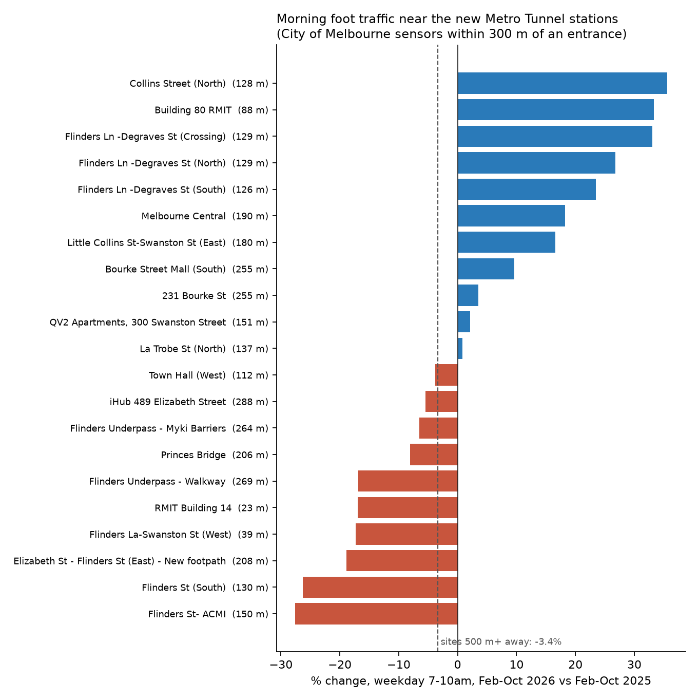
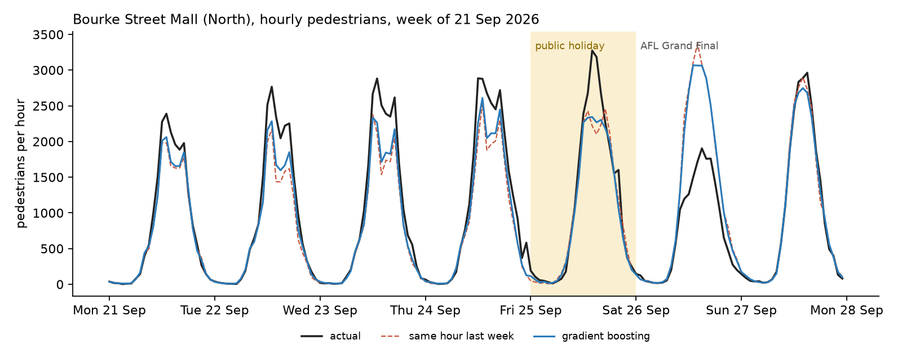

# Melbourne foot traffic: the Metro Tunnel, and forecasting a week ahead

Two questions, answered with 1.6 million hourly counts from the City of Melbourne's pedestrian sensors (Oct 2024 to Oct 2026, 102 sensors):

1. **Did the Metro Tunnel change foot traffic on the streets around its new CBD stations?**
2. **How well can you forecast next week's hourly foot traffic at each sensor, and where does it break?**

Everything below is reproducible from public data with three commands (see [Run it](#run-it)).

## 1. Ten months in, the streets around the new stations look like the rest of the city

The tunnel opened on 30 Nov 2025, and its lines moved in fully on 1 Feb 2026. I compared **1 Feb to 18 Oct 2026 with the same dates in 2025**. Because the calendar window is identical, seasonality cancels out.

Sites within 150 m of a State Library or Town Hall station entrance ("near") are compared with sites more than 500 m away ("far"). A *site* is a group of sensors less than 25 m apart. The three counters on the Flinders Ln / Degraves St corner count as one site, not three.

| measure (median change, 2026 vs 2025) | near (9 sites) | far (47 sites) | difference | permutation p |
| --- | --- | --- | --- | --- |
| all day, every day | +1.1% | -0.5% | +1.6 pts | 0.59 |
| weekday 7-10am | -3.8% | -3.4% | -0.5 pts | 0.92 |
| weekday 4-7pm | +0.6% | -1.4% | +2.1 pts | 0.72 |

*Only sensors working on at least 80% of days in both windows are included.*

**What the data says:** there's no measurable difference between foot traffic near the new stations and further away, on any of the three measures.

**Underneath that flat median, individual corners moved a lot.** On weekday mornings:

| change | sensors |
| --- | --- |
| fell 26-28% | Flinders St (South), Flinders St - ACMI |
| fell 17% | RMIT Building 14 and Flinders La - Swanston St, the two sensors closest to an entrance |
| rose 28-36% | Collins St (North), Building 80 RMIT on Swanston St, and the Degraves St corner (its three counters averaged) |

Sensors can't follow a person from one street to the next, so this shows where counts changed, not where people went. Other changes landed in the same window too. The Big Switch also moved the Frankston line back into the City Loop.



**How sure is this?** The radius is a choice, so here's what happens when it moves. I fixed 150 m before looking at results. The full table is in [`results/metro_tunnel_sensitivity.csv`](results/metro_tunnel_sensitivity.csv).

| near radius | all day | weekday 7-10am | weekday 4-7pm |
| --- | --- | --- | --- |
| 100 m (3 sites) | -6.4 pts, p 0.32 | -13.6 pts, p 0.07 | -8.0 pts, p 0.28 |
| 150 m (9 sites) | +1.6 pts, p 0.58 | -0.5 pts, p 0.91 | +2.1 pts, p 0.74 |
| 200 m (12 sites) | +6.8 pts, p 0.07 | +4.8 pts, p 0.19 | +9.2 pts, p 0.05 |
| 250 m (14 sites) | +3.8 pts, p 0.21 | +1.8 pts, p 0.57 | +3.9 pts, p 0.31 |
| 300 m (18 sites) | +6.8 pts, p 0.04 | +1.8 pts, p 0.57 | +6.7 pts, p 0.05 |

*The sensitivity runs use 2,000 permutations; the headline table uses 10,000.*

- **Wider radii lean positive**, but only 2 of the 15 tests get under p = 0.05.
- **At 100 m the sign flips.**
- Treat this as "no clear effect yet", not as a hidden boost.

**What I got wrong first.** My first pass counted the three Degraves St counters as three separate sensors. That alone produced a "+11% evening effect, p = 0.009"; with the corner counted once, it disappears. The first pass also threw out any day with a missing hour, when most of those gaps are just quiet nights (see [How it handles messy sensor data](#how-it-handles-messy-sensor-data)). An independent re-check caught both before publication.

**Limits:**

- Sensors sit on footpaths, not inside stations, so this measures street activity, not ridership.
- Other things changed between 2025 and 2026 too: return-to-office patterns, events, roadworks and the City Loop changes.
- Nearby sites aren't independent of each other, and the permutation test assumes they are. So the p-values are approximate.
- Flinders Street and Melbourne Central stations sit close to several "near" sites, which blurs the comparison.

## 2. Forecasting next week, hour by hour

A gradient-boosted model predicts each sensor's hourly count up to 7 days ahead. It uses only information you'd have a week in advance:

- hour, day of week and month
- the Victorian public holiday calendar
- the same hour 1-4 weeks earlier

It was trained on Oct 2024 to Aug 2026 and tested on the last 8 weeks: 24 Aug to 18 Oct 2026, 99 outdoor sensors, 130,296 sensor-hours.

| method | WAPE | mean abs. error per hour | WAPE on the public holiday |
| --- | --- | --- | --- |
| same hour last week | 21.3% | 82.9 | 32.6% |
| average of the last 4 weeks | 17.5% | 68.1 | 32.3% |
| **gradient boosting** | **16.7%** | **65.2** | **23.8%** |
| gradient boosting + weather* | 16.1% | 62.7 | 22.4% |

*WAPE = total absolute error divided by total actual count.*

*\*Uses observed temperature and rain as a stand-in for a weather forecast, so it's an upper bound on what weather adds.*

**What the data says:**

- **The model cuts error by 22% against the naive weekly baseline.** Against the stronger 4-week average the gain is only 5%, which is the honest comparison.
- **It earns its keep on holidays.** Error on the holiday in the test window was 23.8%, against about 32.5% for both baselines.
- **The test window holds only one public holiday:** Grand Final Friday, 25 Sep 2026. That's a small sample.



**Where it breaks: the AFL Grand Final.** The model knows a public holiday is coming. It doesn't know which kind.

- **Grand Final Friday (parade day):** across the 97 sensors working that day, actual foot traffic was **23.8% above** the forecast.
- **Grand Final Saturday:** the network came in **20.2% below** the forecast (813,000 actual vs 1,018,210 forecast). Bourke Street Mall (North) was **37.7% below** (17,451 vs 28,020).

Holidays aren't all alike either. **18 of the 26 public holidays in the data were quieter** than a normal same weekday. Grand Final Friday itself went from **7.6% quieter** than a normal Friday in 2025 to **10.3% busier** in 2026. See [`results/holiday_effects.csv`](results/holiday_effects.csv) and [`results/forecast_event_days.csv`](results/forecast_event_days.csv).

An events calendar is the obvious next feature. With only two Grand Finals in the data, it has to be added carefully.

Per-sensor errors are in [`results/forecast_by_sensor.csv`](results/forecast_by_sensor.csv). Busy, regular streets like Elizabeth St come in around 9-14% WAPE. Quiet, event-driven spots like Birrarung Marr are much harder, at 70%+ WAPE.

## Run it

```bash
pip install -r requirements.txt
python fetch.py          # about 35 MB of counts, plus sensor locations and hourly weather
python metro_tunnel.py   # section 1: results/metro_tunnel_*.csv and the chart
python forecast.py       # section 2: results/forecast_*.csv, holiday_effects.csv and the chart (about 1 min)
python test_forecast.py  # checks the data cleaning, lag alignment and distance maths
```

`fetch.py` always pulls the latest data. The live dataset is a rolling two-year window, so re-running later will shift the dates and numbers slightly. The committed `results/` are from data up to 19 Oct 2026 (the partial last day is excluded).

## How it handles messy sensor data

- **The feed leaves out empty hours.** Real zeros almost never appear: only 143 of 1.6M rows are 0, while counts of 1 at 3am are common. So a missing hour on a day the sensor was working is read as **zero pedestrians**.
- **Outages:** a day with any missing hour between 8am and 6pm, or a zero total, is treated as a **sensor outage**. The whole day is excluded, and it can't leak into lag features.
- **Sites:** sensors less than 25 m apart are one site in the Metro Tunnel comparison, so a busy corner with three counters doesn't get three votes.
- **Coverage:** for the Metro Tunnel comparison, a sensor needs to be working on at least 80% of days in both years.
- **Indoor sensors** (library and community-hub doors) are left out of both analyses.

## Data and credits

- Pedestrian counts and sensor locations: City of Melbourne Open Data. Datasets `pedestrian-counting-system-monthly-counts-per-hour` and `pedestrian-counting-system-sensor-locations`.
- Hourly weather: [Open-Meteo](https://open-meteo.com/) (CC BY 4.0).
- Metro Tunnel entrance locations: © OpenStreetMap contributors (ODbL).
- Victorian public holidays: the [`holidays`](https://pypi.org/project/holidays/) package.

Python, pandas, scikit-learn (HistGradientBoostingRegressor, Poisson loss), matplotlib.

Built by Vedant Kinikar, Master of Data Science, RMIT University.
